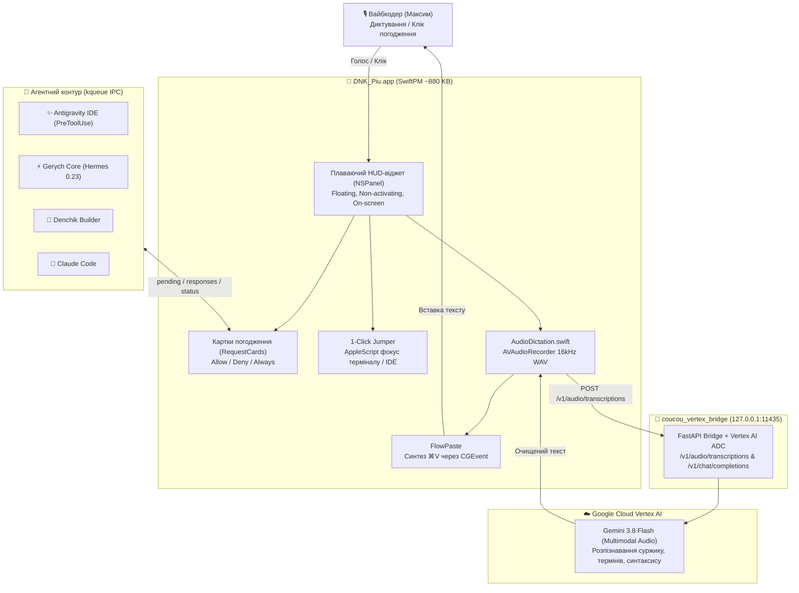

# 💎 DNK_Piu (ДНК Піу)

> **Суверенний ультралегкий macOS HUD-компаньйон та голосове диктування для AI-агентів розробника.**  
> Побудований на чистому SwiftPM (~1 500 рядків коду, бінарник **< 1 МБ**, **< 30 МБ RAM**) з інтеграцією в **Google Cloud Vertex AI (Gemini 3.8 Flash Multimodal Audio)**.

[](https://apple.com)
[](https://swift.org)
[](LICENSE)
[](https://cloud.google.com/vertex-ai)

---

## ⚡ Чому DNK_Piu?

Більшість існуючих desktop-оболонок для ШІ (Coucou тощо) мають серйозні недоліки:
- **Перевантажені**: 50k+ рядків Swift, прив'язані до повного `Xcode.app`, вимагають гігабайти пам'яті.
- **Прив'язка до чолки**: Ламаються на MacBook Pro 13" M1 / Mac mini / зовнішніх моніторах, де немає фізичного notch.
- **Важкі локальні моделі**: Тягнуть 650+ МБ ваг Whisper на SSD, гріють процесор і садять батарею.

**`DNK_Piu` вирішує це радикально**:
1. 🚀 **Ультрашвидка збірка за секунди**: Чистий SPM (`swift build -c release`) прямо з `CommandLineTools` без важкого Xcode.
2. 🪶 **Мікроскопічний футпринт**: бінарник **880 КБ**, споживання оперативної пам'яті **< 30 МБ**.
3. 🎙️ **Суверенне диктування через Vertex AI**: Запис аудіо 16kHz WAV та миттєва мультимодальна транскрипція через **Gemini 3.8 Flash** (< 1.5 сек, розуміє українську розробницьку мову, сленг, синтаксис та англійські назви).
4. 🛡️ **1-Click Tool Approvals**: Інтерактивні картки підтвердження команд (`Allow`, `Deny`, `Always`) для **Antigravity IDE**, **Gerych**, **Denchik** та **Claude Code**.
5. ⚡ **1-Click Jumper**: Миттєве фокусування вікна агента (Ghostty, Terminal, iTerm2, Cursor, VS Code).
6. 📋 **FlowPaste**: Автоматична безпечна вставка розпізнаного тексту в активне поле вводу через емуляцію `⌘V`.

---

## 🏛️ Архітектура системи



---

## 🛠️ Встановлення та запуск

### 1. Передумови
- macOS 13.0+ (Apple Silicon M1/M2/M3/M4 або Intel).
- Встановлені Xcode Command Line Tools (`xcode-select --install`).
- Запущений локальний міст Vertex AI (`coucou_vertex_bridge.py` на `127.0.0.1:11435`).

### 2. Швидке встановлення
```bash
git clone https://github.com/dnk-ecom/DNK_Piu.git
cd DNK_Piu
./install.sh
```

Скрипт скомпілює оптимізований релізний бінарник, упакує бандл `DNK_Piu.app` у `~/Applications/` та автоматично запустить його.

### 3. Видалення
```bash
./uninstall.sh
```

---

## 🧩 Інтеграція з агентами (Hooks)

### Antigravity IDE & Gerych Core
У конфігурації хуків агента (`hooks/piu_hook.py`) додається перевірка небезпечних операцій:
```python
from hooks.piu_hook import request_approval_blocking

# Блокуючий запит перед деструктивною дією:
allowed = request_approval_blocking(
    tool_name="run_command",
    command="rm -rf /tmp/build",
    cwd="/Users/kuzmenko.top/project",
    agent="Antigravity",
    timeout=60.0
)
if not allowed:
    print("Action rejected by developer via DNK_Piu.")
```

---

## 🧪 Тестування

Для перевірки коректності компонентів запустіть вбудований тестовий набір:
```bash
python3 Tests/test_piu.py
```

---

## 📄 Ліцензія

Розробка ведеться під ліцензією **GNU Affero General Public License v3.0 (AGPLv3)**.  
Архітектурний донор: чисте ядро `agent-huddle` (MIT License, Brendon Ang).
